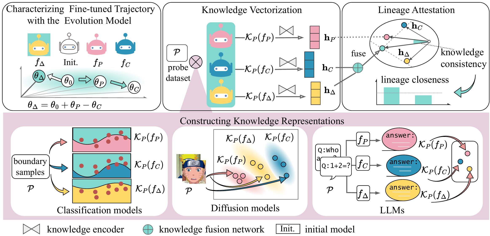

# Model Lineage

Code for **[Attesting Model Lineage by Consisted Knowledge Evolution with Fine-Tuning Trajectory](https://www.usenix.org/conference/usenixsecurity26/presentation/shang)** (USENIX Security 2026).

Zhuoyi Shang, Jiasen Li, Pengzhen Chen, Yanwei Liu, Xiaoyan Gu, Weiping Wang

[Paper](https://www.usenix.org/conference/usenixsecurity26/presentation/shang) | [PDF](https://www.usenix.org/system/files/usenixsecurity26-shang.pdf) | [arXiv](https://arxiv.org/abs/2601.11683) | [Artifact](https://zenodo.org/records/17958570) | [BibTeX](#citation)

We verify model lineage by checking the consistency between knowledge evolution and parameter changes along fine-tuning trajectories. The code covers image classifiers, large language models, and diffusion models.

<p align="center">
  
</p>

*Overview of the model lineage attestation framework (Figure 3 in the paper).*

## Installation

Use Python 3.12 with a compatible [PyTorch build](https://pytorch.org/get-started/previous-versions/). [Git LFS](https://git-lfs.com/) is required to download the released embeddings and checkpoints.

```bash
GIT_LFS_SKIP_SMUDGE=1 git clone https://github.com/Tthvic/Model_lineage.git
cd Model_lineage
git lfs install --local

conda create -n lineage python=3.12 -y
conda activate lineage
python -m pip install torch==2.13.0 torchvision==0.28.0 --index-url https://download.pytorch.org/whl/cu130
python -m pip install -r requirements.txt
```

Run all commands from the repository root. Fetch only the artifacts needed for each example using the commands below.

## Quick Start

### MobileNet and ResNet

Download the test embeddings and pretrained lineage detectors:

```bash
git lfs pull --include="data/embeddings/small_model/**,data/models/small_model/**"
```

Evaluate MobileNet:

```bash
python scripts/small_model/train_lineage.py \
    --evaluate \
    --model_arch mobilenet \
    --checkpoint data/models/small_model/mobilenet_model.pth \
    --data_dir data/embeddings/small_model/test_M_data.pth
```

Evaluate ResNet:

```bash
python scripts/small_model/train_lineage.py \
    --evaluate \
    --model_arch resnet \
    --checkpoint data/models/small_model/resnet_model.pth \
    --data_dir data/embeddings/small_model/test_R_data.pth
```

### Qwen

Train and evaluate a lineage detector on the bundled ARC-Challenge embeddings for Adapter and Merge models:

```bash
git lfs pull --include="data/embeddings/llm/Qwen-1.5B/**"
python scripts/llm/qwen_knowledge_relation_training.py
```

This example trains for 100 epochs using settings in the script. Results are saved to `data/intermediate/llm/Qwen-1.5B/results/`. See the [LLM guide](docs/experiments.md#large-language-models) for the full workflow and data layout.

## Documentation

| Topic | Guide |
| --- | --- |
| Released embeddings and checkpoints | [Artifact downloads](docs/experiments.md#released-artifacts) |
| MobileNet / ResNet | [Data preparation and training](docs/experiments.md#small-models) |
| Large language models | [Model downloads, embeddings, and training](docs/experiments.md#large-language-models) |
| Diffusion models | [Embedding generation and evaluation](docs/experiments.md#diffusion-models) |
| Adaptive attacks | [Attack implementations](docs/experiments.md#adaptive-attacks) |
| Baselines | [Baseline code and instructions](docs/experiments.md#baselines) |

The [Zenodo archive](https://zenodo.org/records/17958570) contains the December 2025 artifact; GitHub contains subsequent updates.

## Citation

If you find this work useful, please cite our paper:

```bibtex
@inproceedings{shang2026attesting,
  author    = {Zhuoyi Shang and Jiasen Li and Pengzhen Chen and Yanwei Liu and Xiaoyan Gu and Weiping Wang},
  title     = {Attesting Model Lineage by Consisted Knowledge Evolution with {Fine-Tuning} Trajectory},
  booktitle = {35th USENIX Security Symposium (USENIX Security 26)},
  year      = {2026},
  isbn      = {978-1-939133-58-8},
  address   = {Baltimore, MD},
  pages     = {4483--4502},
  url       = {https://www.usenix.org/conference/usenixsecurity26/presentation/shang},
  publisher = {USENIX Association},
  month     = aug
}
```

Original code and documentation are licensed under [CC BY 4.0](LICENSE). See [third-party notices](THIRD_PARTY_NOTICES.md) for external code, datasets, and models.
